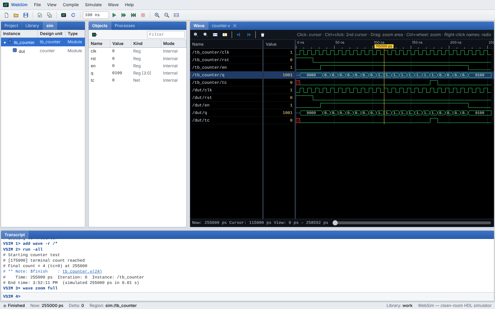

# WebSim — browser-based Verilog / VHDL simulator

WebSim is an HDL simulator that runs entirely in the browser, with the classic
desktop-simulator workflow: design libraries, `vlog` / `vcom` compilation,
`vsim` elaboration, a Tcl-style transcript console, structure / objects /
processes panels, a source editor and a waveform viewer.

> 웹 브라우저에서 동작하는 Verilog/VHDL 시뮬레이터입니다. `vlib → vlog/vcom → vsim → add wave → run`
> 으로 이어지는 전통적인 HDL 시뮬레이터 작업 흐름을 그대로 제공하며, 클린룸 방식으로 처음부터 구현했습니다.



WebSim is a **clean-room** implementation. It was written from a functional
specification ([docs/SPEC.md](docs/SPEC.md)) based on public knowledge of how
such tools behave and on the IEEE 1364 / 1076 standards. It contains no code or
assets from any commercial simulator and is not affiliated with any vendor.

## Quick start

```bash
npm install
npm run dev      # open the printed URL
npm test         # engine test suite (Vitest)
npm run build    # static site in dist/ (deployable anywhere, e.g. GitHub Pages)
```

On first launch WebSim loads the counter example and runs it. Try the other
examples under **File ▸ Load Example**, or type in the transcript:

```tcl
vlib work
vlog counter.v tb_counter.v
vsim work.tb_counter
add wave -r /*
run -all
```

## Features

**Workflow and UI**
- Project panel (files, compile status, compile order), Library panel (compiled units; double-click to simulate), `sim` structure tree, Objects (live values, force/examine, drag to wave), Processes.
- Transcript with `VSIM n>` prompt, history (↑/↓), Tab completion of commands, files and hierarchy paths, clickable `file(line)` error links.
- CodeMirror source editor with Verilog / VHDL / Tcl highlighting, `Ctrl+S`, `F7` compile.
- Wave window: logic and bus rendering (X red, Z blue), per-signal radix (binary / hex / unsigned / signed / octal / ASCII / symbolic enums), two cursors with Δ time, drag-to-zoom, `Ctrl+wheel` zoom, Tab/Shift+Tab edge navigation, dividers, drag-and-drop reordering.
- Run / Continue / Run -All / Break / Restart; run length field; status bar with time, delta and region.
- Files and compiled libraries persist in browser storage; import/export of files and whole projects; light and dark themes.

**Commands**: `vlib vmap vdel vlog vcom vsim run restart quit add wave delete wave force noforce examine env find show describe do radix ls pwd echo history clear help` — `force` supports `v1 t1, v2 t2 -repeat period -cancel t` clock patterns.

**Verilog / SystemVerilog**: modules (ANSI and non-ANSI ports), parameters and `#()` overrides, `wire/reg/integer/logic/bit/int`, signed arithmetic, memories, `assign`, `always`, `always_ff/comb/latch`, `initial`, blocking / non-blocking assignment with intra-assignment delay, `if/case/casez/casex/for/while/repeat/forever`, `@(posedge/negedge … or …)`, `@*`, `wait`, named blocks and `disable`, functions (recursive) and tasks, `generate for/if`, gate primitives, `typedef enum`, `.*` connections, hierarchical references, `` `timescale `define `ifdef `include ``, and the common system tasks (`$display $write $strobe $monitor $finish $stop $time $random $readmemh/b $signed $clog2 …`).

**VHDL**: entities/architectures, packages and package bodies, generics/ports, `std_logic(_vector)`, `unsigned/signed`, integer/natural/boolean/time, enumerations, array types (memories), subtypes, processes with sensitivity lists or `wait on/until/for`, conditional and selected signal assignment, `after` delays, component and direct entity instantiation, `for/if generate`, functions and procedures, `assert/report/severity`, attributes (`'event 'range 'length 'high 'low 'image`), numeric_std conversions, `rising_edge/falling_edge`, `std.env.stop/finish`.

**Mixed language**: Verilog can instantiate VHDL entities and vice versa (see the ALU example).

**Kernel**: 4-state values, delta cycles with active / inactive / NBA / postponed regions, resolved multi-driver nets, forced signals, full value history for every signal (signals added to the wave after a run still show their complete waveform).

## Known limitations

- SystemVerilog: interfaces (modports not enforced), basic classes (no parameterized classes, randomization, constraints, queues or dynamic arrays) and a subset of SVA (no `throughout/within/intersect`, `[->]`/`[=]` repetition or property arguments).
- VHDL configurations support component bindings (`use entity` / `use configuration` / `use open`) but not generic/port maps inside the configuration.
- No code coverage; no WLF export.

## Project layout

| Path | Purpose |
|---|---|
| `src/engine/logic.ts` | 4-state bit-vector arithmetic |
| `src/engine/verilog/` | Verilog preprocessor, lexer, parser |
| `src/engine/vhdl/` | VHDL lexer, parser |
| `src/engine/ast.ts` | Language-neutral design AST |
| `src/engine/elab.ts` | Elaboration and closure compiler |
| `src/engine/kernel.ts` | Event-driven simulation kernel |
| `src/engine/library.ts` | Compiled-unit libraries |
| `src/engine/commands.ts` | Transcript command interpreter |
| `src/engine/format.ts` | `$display` / time formatting |
| `src/ui/` | Browser UI (panes, editor, transcript, wave viewer) |
| `tests/` | Vitest suite (logic, parsers, Verilog & VHDL simulation, commands, examples) |
| `docs/SPEC.md` | Clean-room functional specification |

## License

MIT — see [LICENSE](LICENSE).
